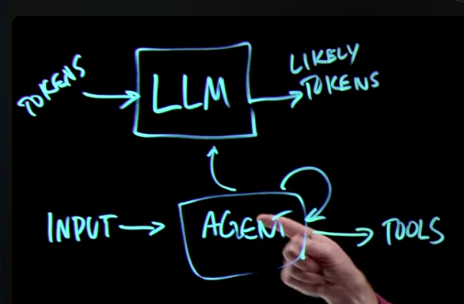
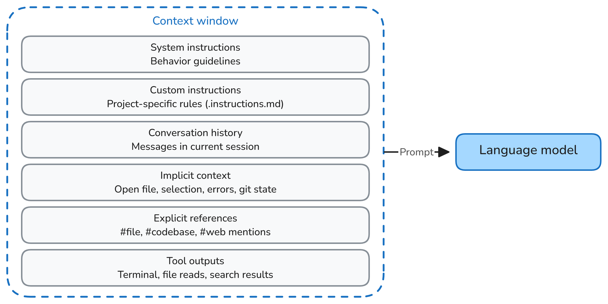
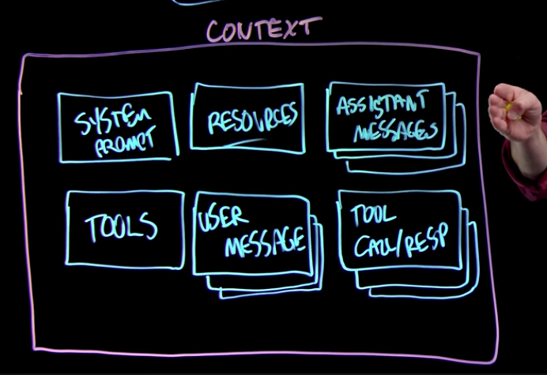
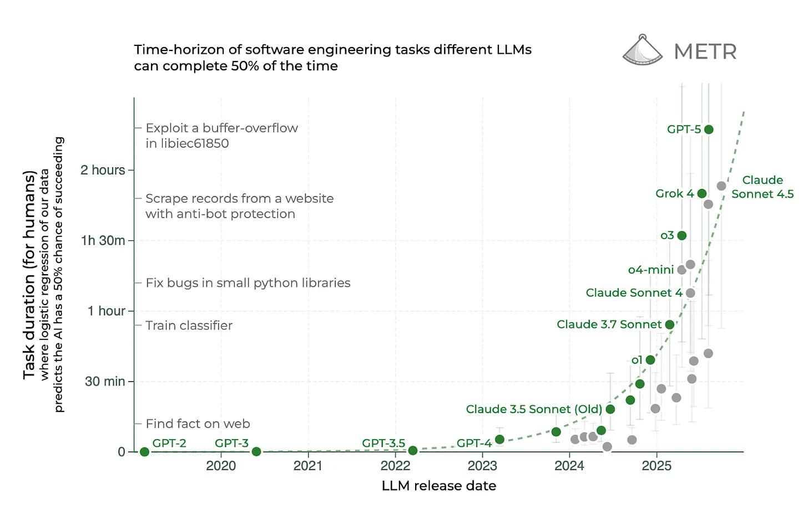
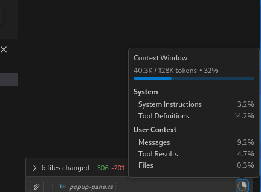
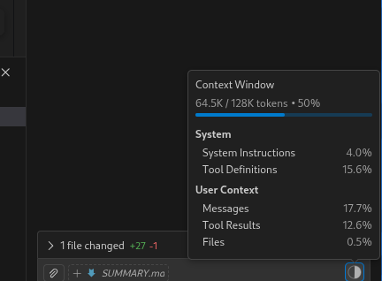
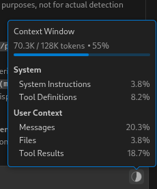
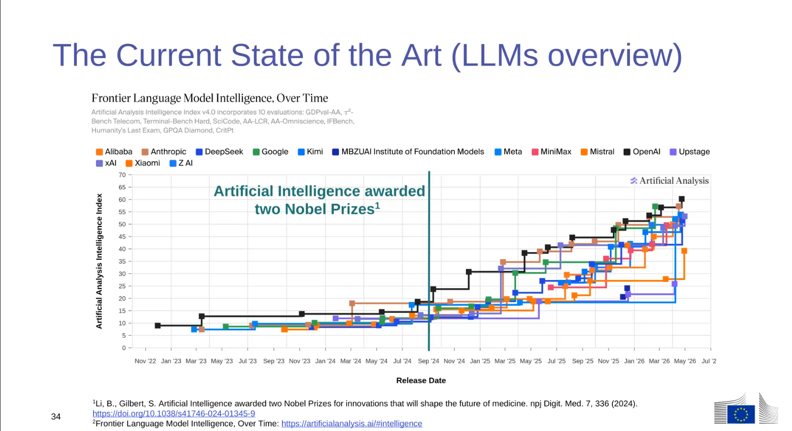

# AI-presentation Ispra 2026 Mar

## 7 Milestones of Agentic AI Evolution

- [Old AI agent milestones](https://medium.com/wonder-think/the-fascinating-history-of-agentic-artificial-intelligence-14c4f3c6b58e)

```
2022-Nov: ChatGPT Launch: Conversational AI goes mainstream
|
2023-Mar: GPT-4 with Function Calling: Agents can now interact with external tools and APIs
|
|
|
2023-Nov: Extended Context Windows (128k): Agents can maintain coherent plans across large codebases
|
|
2024-Jun-Nov: Claude 3.5 Sonnet: Superior code generation with reasoning traces visible to users
|
|
2024-Nov: Model Context Protocol (MCP): Universal tool integration standard
Test-Driven Agent Workflows, Integration with linters/type checkers
|
2025-Sep: Claude Sonnet 4.5
          Multi-step autonomous "no-hands" coding, completing complex tasks without humans
|
2025-Oct: NVIDIA'r Spark DGX, "home" AI rig
|
2026-Apr: First FOSS contender, DeepSeek v4 (1.6T params, 49B active, 1M tokens)
```

The explosion in utility came from combining:
**agentic loop** + **tool access** + **extended context**
alledgedly leading to **autonomous execution**

- [Claude's 5 Levels of AI Coding](https://www.youtube.com/watch?v=bDcgHzCBgmQ)
  evels-of-AI-coding.png)

---

## Agentic loops + tools

- 
- [2026 Jan Burke Holland: Level Up Your VS Code Productivity](https://www.youtube.com/watch?v=0XoXNG65rfg)

- [Author your own LLM Agent from scratch](https://fly.io/blog/everyone-write-an-agent/)
  A simple agent (without tools):

  ```python
  from openai import OpenAI

  client = OpenAI()
  context = []

  def call():
      return client.responses.create(model="gpt-5", input=context)

  def process(line):
      context.append({"role": "user", "content": line})
      response = call()
      context.append({"role": "assistant", "content": response.output_text})
      return response.output_text
  ```

## High-frequency Testing & Feedback

(only for code) AI increases the frequency of the code chunks authored.
[Test frequency must stay below nyquist limit](https://www.youtube.com/watch?v=XavrebMKH2A)

- Test statically:
  - use compiler
  - python: use typings & rum [`ty`](https://github.com/astral-sh/ty) (instead of the slow `mypy`)
  - javascript: use TypeScript
  - Lint
- Test runtime:
  - run unit-tests & integration tests
  - Stealth schenarios
- well-structured logging & error handling (eg `gcc`)


## Context engineeging (and not Vibe Coding)

- Before ~2025 Software Engineering utilized LLMs via naive prompting (copy-paste-in-the-loop)
- Prompting was not quantitative, context occupation ratio, it was!
- Context engineeging was born
- After ~2025 the picture reversed: AI Orchestration platforms teached Agents to  utilize Software Engineering technics

- AI Orchstration platforms:
  - **VSCode-based** Copilot/Claude-Cowork/Cursor/Windsurf,
  - Claude/Copilot/Gemini CLI,
  - OpenClaw, OpenAgentic,
  - NotebookLM (Agent minus the MCP tools)
- ctxteng concepts: instruction files, MCP tools, SKILLS, hooks, [kiro bugfixing](https://kiro.dev/blog/bug-fix-paradox/)

 Framework | Slash Commands | @-mentions | #-tools | Model Support | Notes |
|-----------|----------------|------------|---------|---------------|-------|
| **GitHub Copilot** | ✅ Extensive (25+) | ✅ Yes (`@github`, `@terminal`, `@vscode`) | ✅ Extensive (40+) | GPT-4, Claude 3.5, o1, Gemini (plan-dependent) | Most comprehensive context system |
| **Claude Cowork** | ⚠️ Limited | ⚠️ Basic | ✅ Via MCP | Latest Claude (API) | MCP-native, autonomous workflows |
| **Cursor** | ⚠️ Basic (`/doc`, `/fix`, `/test`) | ✅ Yes (`@Codebase`, `@Docs`, `@Web`) | ❌ Different system | GPT-4, Claude 3.5, custom | AI-first IDE, fork of VS Code |
| **Windsurf (Codeium)** | ⚠️ Basic (`/doc`, `/explain`) | ✅ Yes (`@Codebase`, `@Web`, `@Terminal`) | ❌ Different system | Proprietary + Claude | Flow mode for multi-file edits |


## Context-size matter

- 
- Context rot, drift, Attention dilution, [“lost in the middle” effect in RAGs](https://medium.com/@cenghanbayram35/lost-in-the-middle-in-llms-86e461dc7212), or attention sink

- [2025 Nov: Context rot undrepinings](https://www.understandingai.org/p/context-rot-the-emerging-challenge)
  - umans.png)
  - [Paper Sep 2025: SepContext Is What You Need: The Maximum Effective Context Window for Real World Limits of LLMs](https://arxiv.org/abs/2509.21361)
  - [Paper Feb 2025: NoLiMa: Long-Context Evaluation Beyond Literal Matching](https://arxiv.org/abs/2502.05167)
- [Blog May 2025 May: Structure *context* with Markdown and cross-link its resources](https://medium.com/@wetrocloud/why-markdown-is-the-best-format-for-llms-aa0514a409a7)
- [semi-paper 2026 Feb: LLM-generated contexts](https://www.emergentmind.com/topics/llm-generated-context-files)

## AI Tokens <--> words/LoCs (roughly)

General Ratios (1 Token Equals):
- English Prose: ~0.75 words/token (or ~4 characters)
- Code (Python/JS): ~0.5 words / token (or ~2–3 tokens per word)
- Code (Python/JS): 3-10 token / LoC
Comparison ~1000 tokens:
- Text: x1 A4-page ~= 100 LoCs

- , , ze-3.png), 


## Skills can conditionally customize your LLM

A user-method to move instructions out of context:

- [Skills in awesome-copilot](https://github.com/github/awesome-copilot)
- [2026 Feb Burke Holland: Skills tutorial](https://www.youtube.com/watch?v=fabAI1OKKww)


## Payment

- Developers of "popular" FOSS projects get [a free Copilot Pro subscription](https://github.com/orgs/community/discussions/165153)
- [models available to copilot plans](https://docs.github.com/en/copilot/reference/ai-models/supported-models#supported-ai-models-per-copilot-plan)
- API-use is always premium, through cli/copilot the tool

## Claude CLI vs Copilot (vs Gemini)

- [Tips for Coexisting GitHub Copilot Settings with Claude Code and Other AI Tools](https://zenn.dev/kesin11/articles/20251210_ai_agent_symlink?locale=en)

## Agentic coding frameworks/harnesses:
- [Superpowers vs. BMAD vs. SpecKit vs. GSD](https://ai.plainenglish.io/the-great-framework-showdown-superpowers-vs-bmad-vs-speckit-vs-gsd-360983101c10)
- [The Force Won't Save Your PR: Catch AI Slop Before It Ships](https://www.youtube.com/watch?v=YcA4TPEtEyQ)
  GSD vs BMAD 2026 agentic loop harnesses

## Resource links

- [2025 State of AI-assisted software DORA report (PDF)](https://services.google.com/fh/files/misc/2025_state_of_ai_assisted_software_development.pdf)
- [Feb 2026 confluence youtube: Context engineering video (aka Prompt engineering is dead)](https://www.youtube.com/watch?v=Cs7QiSi8KLY&list=PLQmImZv_mq3TWN0UhoayCzmEYbWaTcdWu&index=16&t=21s)
- [Jan 2026 youtube: Study 150 Developers Using AI](https://www.youtube.com/watch?v=b9EbCb5A408&list=PLQmImZv_mq3TWN0UhoayCzmEYbWaTcdWu&index=16) which refers to this
- [Paper Jul 2026: Echoes of AI: Investigating the Downstream Effects of AI Assistants on Software Maintainability](https://arxiv.org/abs/2507.00788)
- [Jan 2026 blog: AI-Ready dev – Same Game, Different Dice](https://codemanship.wordpress.com/2026/01/05/the-ai-ready-software-developer-conclusion-same-game-different-dice/)
- [2025 MS study on 300.000 employees deploying *Copilot* on *Microsoft 365* (PDF)](https://www.microsoft.com/insidetrack/blog/uploads/prod/2024/04/10602-Copilot-Deployment_EBOOK.pdf)
- [Paper Jan 2026: AI negatively impacts skill formation](https://x.com/LuizaJarovsky/status/2026653994118984051)
- I works best in Languages you don't understand
- [Signs of AI](https://en.wikipedia.org/wiki/Wikipedia:Signs_of_AI_writing)
- 

## Ispra

- Claude Cowork ([to replace copilot](https://www.youtube.com/watch?v=TR7IOm9IQx0)?)
  - Copilot for most people means MS365
. **Claude in Chrome** extension is more important than Cowork

## Andres presentation

- 
